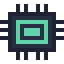

# Minnion-Plugins

The plugins for [MinnionDeck](https://github.com/minnnion/MinnionDeck). The app's **Marketplace** page and the MinnionDeck setup read this repository: they install the plugins you choose and add each one's ready-made profile to your deck.

| | Plugin | What it does | Version | Profile |
|---|---|---|---|---|
|  | **[Case Lights](plugins/minnion_lights)** | Finds out why your PC's case lights act up, and sets them for you. | 0.4.1 | Yes |
|  | **[Soundboard](plugins/minnion_soundboard)** | Play sound files from your keys. | 0.1.0 | Yes |
|  | **[Speech](plugins/minnion_speech)** | Reads text aloud with 37 natural US and UK voices, on this PC. | 0.1.0 | — |
|  | **[Spotify](plugins/minnion_spotify)** | Play, skip, like, volume and now playing. | 0.1.0 | Yes |
|  | **[System Monitor](plugins/minnion_sysmon)** | CPU, GPU, memory, disk, network and the busiest app, live. | 0.2.0 | Yes |
|  | **[Timer](plugins/minnion_timer)** | Countdowns, a stopwatch, a focus timer and a clock. | 0.1.0 | Yes |
|  | **[Weather](plugins/minnion_weather)** | The weather now, highs and lows, rain, wind, air quality and more. | 0.2.0 | Yes |

## Install a plugin

- In MinnionDeck, open **Marketplace** and press **Install**. Its profile is added as a new profile with its pages.
- Or tick it in the [MinnionDeck setup](https://github.com/minnnion/MinnionDeck/releases/latest) when you install the app.

Every plugin is signed, and the app checks each download against the SHA-256 in `index.json` before it installs.

## What's in here

```
index.json                      the list the app reads: names, versions, sizes, SHA-256, profiles
plugins/<id>/
  <id>-<version>.mdplugin       the plugin
  <Name>.mdprofile              its ready-made profile (pages and buttons)
  icon.png, icons/              its pictures
  README.md                     what it does, its actions and settings
```