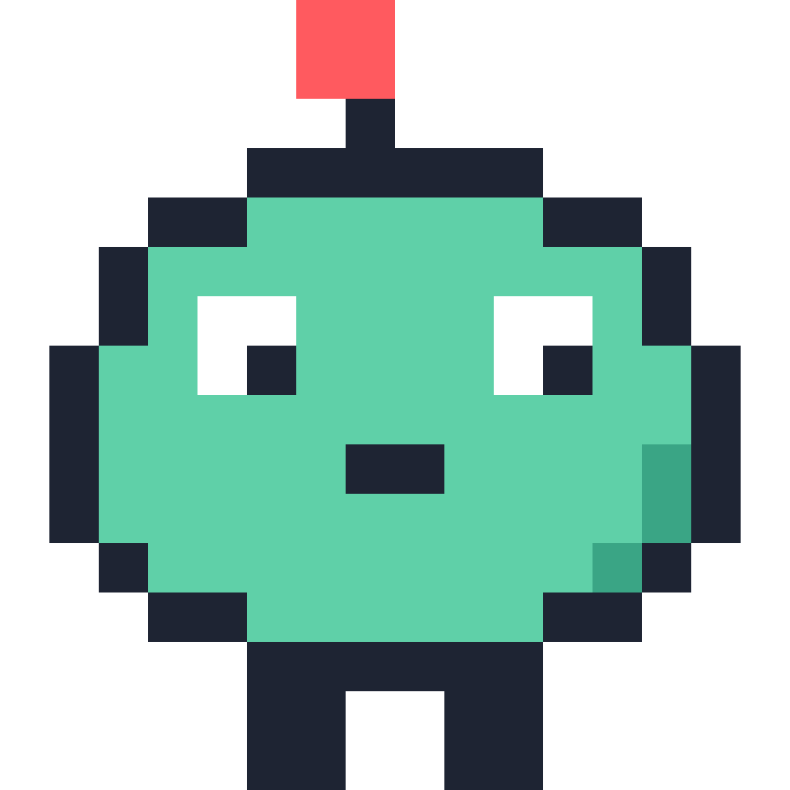
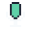
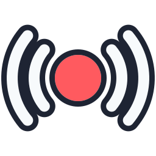
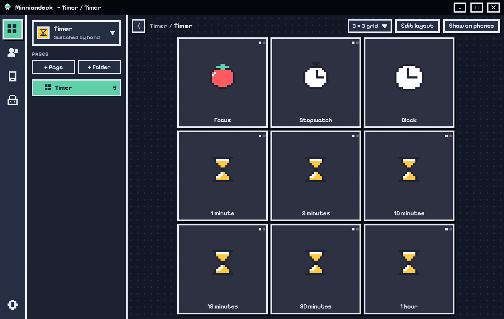
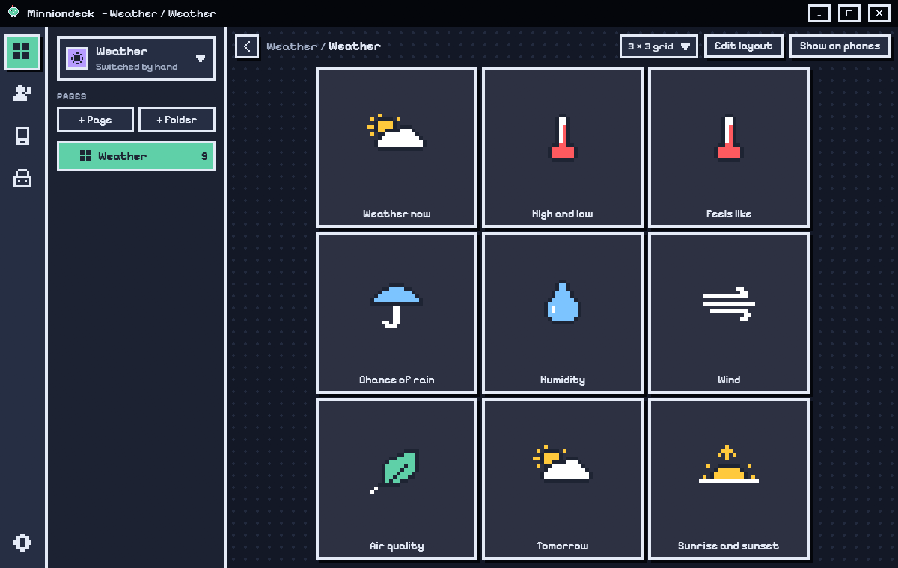
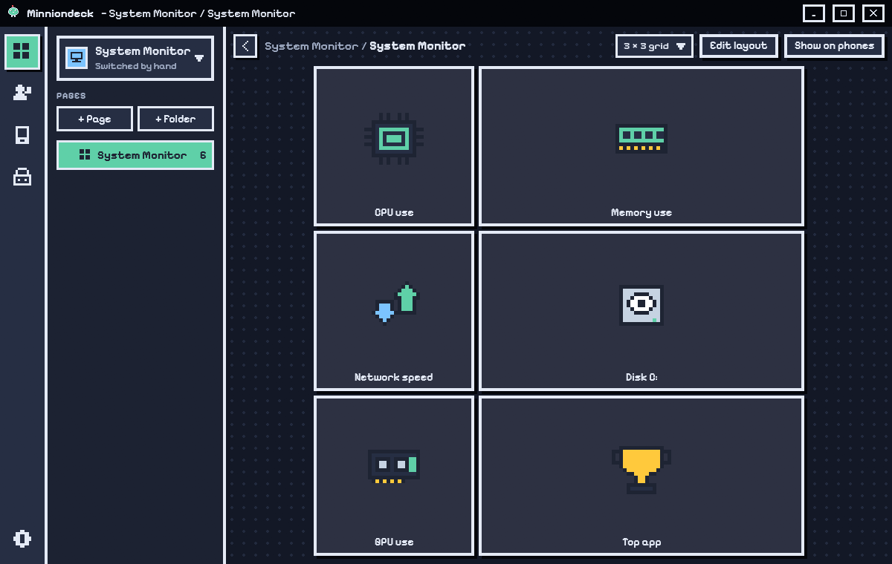
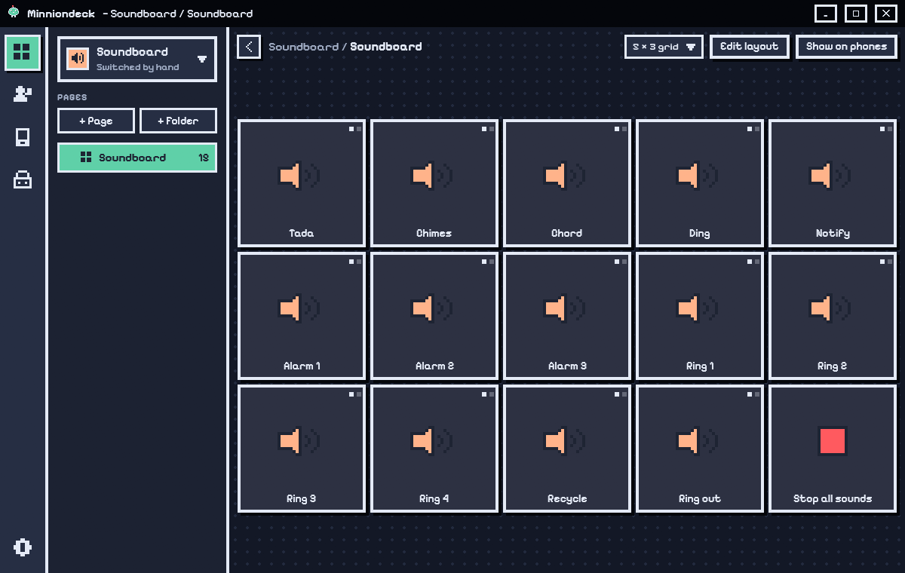
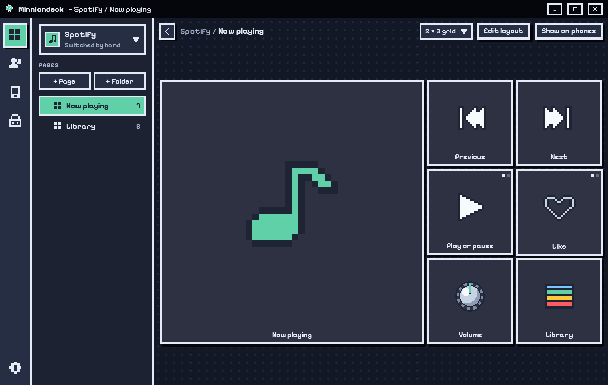
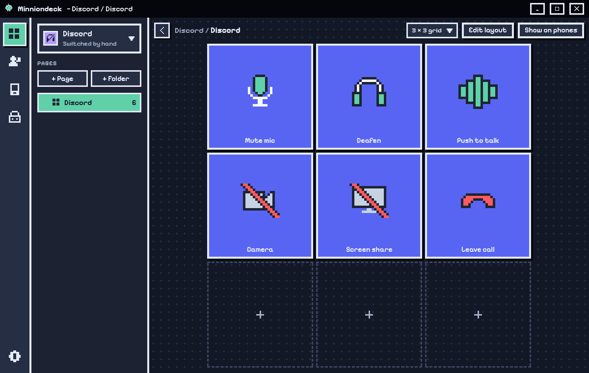

<div align="center">



# Minnion-Plugins

**The official plugins for [MinnionDeck](https://github.com/minnnion/MinnionDeck).**
Each one adds a set of ready-to-use buttons to your deck, with a profile that's set up for you.


**[Get MinnionDeck](https://github.com/minnnion/MinnionDeck/releases/latest)** · **[Plugins](#the-plugins)** · **[Install](#install-a-plugin)** · **[What's in here](#whats-in-here)**

</div>

---

## The plugins

| | Plugin | What it does | Version | Size |
|---|---|---|---|---|
|  | **[Timer](#timer)** | Countdowns, a stopwatch, a focus timer and a clock. | 0.1.0 | 158 KB |
|  | **[Weather](#weather)** | The weather now, highs and lows, rain, wind, air quality and more. | 0.2.0 | 1.0 MB |
|  | **[System Monitor](#system-monitor)** | CPU, GPU, memory, disk, network and the busiest app, live. | 0.2.0 | 172 KB |
|  | **[Soundboard](#soundboard)** | Play sound files from your keys. | 0.1.0 | 165 KB |
|  | **[Spotify](#spotify)** | Play, skip, like, volume and what's playing. | 0.1.0 | 1.2 MB |
|  | **[Discord](#discord)** | Mute, deafen, camera, screen share, push to talk and leave call, live. | 0.1.0 | 1.0 MB |
|  | **[Streaming](#streaming)** | OBS Studio, Twitch and YouTube chat on your keys, live. | 0.2.0 | 1.4 MB |

Every plugin comes with its own profile, so the buttons are on your deck the moment it's installed.

---

### Timer



Live timers on your keys. Press to start or pause, hold to reset. The focus timer (Pomodoro) switches between focus and breaks by itself, and a finished timer beeps and pops up a message.

- **Buttons:** Countdown, Stopwatch, Focus timer (Pomodoro), Clock
- **Settings:** Beep when a timer ends
- **Profile:** one page with a focus timer, a stopwatch, a clock and six one-press countdowns

### Weather



The weather for your home town (or any town) on your keys: now with a matching picture, today's high and low, feels like, chance of rain, humidity, wind, air quality, tomorrow, and the next sunrise or sunset. Updated every 15 minutes; press a key to hear it in full. Weather data by [Open-Meteo](https://open-meteo.com), free and with no account.

- **Buttons:** Current weather, Weather detail
- **Settings:** Home town, Units
- **You need:** an internet connection

### System Monitor



Shows how busy your PC is, right on your keys, read straight from Windows: CPU, GPU and memory use, free disk space, network speed, and the app using the most CPU, memory or GPU right now. Press a key to open Task Manager, or a disk key to open that drive.

- **Buttons:** CPU use, Memory use, Disk space, Network speed, GPU use, Top app

### Soundboard



Each key plays an MP3, WAV, WMA or M4A file at its own volume. Press again to stop it or start it over, and one key stops everything. Uses Windows' own player, so nothing else is needed.

- **Buttons:** Play a sound, Stop all sounds
- **You need:** your own sound files

### Spotify



Controls Spotify from your deck and shows what's playing on a key. You sign in once in your browser and MinnionDeck keeps you signed in.

- **Buttons:** Now playing, Previous song, Next song, Play or pause, Like the song, Spotify volume, Spotify library
- **Settings:** Spotify Client ID, Sign in, Log out
- **You need:** a Spotify account, and your own Client ID from [developer.spotify.com](https://developer.spotify.com) (free, takes a minute)

### Discord



Controls Discord's voice from your deck, and each key shows Discord's live state: mute your mic, deafen, turn your camera on or off, share your screen, switch push to talk and voice activity, and leave the call. Keep Discord open. The first time, Discord asks you to **Authorize** MinnionDeck; after that it connects by itself.

- **Buttons:** Mute mic, Deafen, Camera, Screen share, Push to talk, Leave call
- **Settings:** Connect, Disconnect
- **Profile:** one page with all six buttons, in Discord's colours
- **You need:** the Discord app, open on this PC

### Streaming

Go live, record, switch scenes, mute sources and save replays in OBS, with each key showing OBS's live state. With OBS on this PC there's nothing to type: tick **Enable WebSocket server** in OBS (Tools › WebSocket Server Settings) and it connects by itself. Sign in to Twitch once for viewers, followers, chat, clips, markers, ads and chat modes. Type your YouTube @handle to read your live chat, with no sign-in. Set up only the ones you use.

- **Buttons:** Go live, Record, Pause recording, Switch scene, Mute a source, Show or hide a source, Replay buffer, Save replay, Viewers, Followers, Live chat, Make a clip, Stream marker, Run an ad, Slow mode, Emote-only chat, Send a chat message, Set stream title, YouTube Live chat
- **Settings:** Check OBS, Sign in to Twitch, Check YouTube chat, YouTube channel, Twitch chat to show
- **Profile:** a page each for OBS, Twitch and YouTube; pick the ones you use
- **You need:** OBS Studio 28 or newer for the OBS keys, and a Twitch account for the Twitch keys

---

## Install a plugin

1. Get **MinnionDeck** from its [Releases](https://github.com/minnnion/MinnionDeck/releases/latest).
2. Tick the plugins you want in the setup, **or** open the **Marketplace** page in the app later and press **Install**.
3. Its profile is added with it. Pick it on the **Profiles** page, or let MinnionDeck switch to it by itself.

Updates show up on the Marketplace's **Updates** tab.

## Safe to install

- **Signed.** Every plugin here is signed with the MinnionDeck author key, which the app trusts. A plugin from anyone else only runs if you trust its author or turn on Developer mode.
- **Checked.** Before installing, the app compares each download with the size and SHA-256 listed in `index.json`, and refuses it if they don't match.
- **Kept apart.** Plugins run in a separate helper process, so a plugin that stops can't take the app down with it.

## What's in here

```
index.json                       the list the app and the setup read:
                                 names, versions, sizes, SHA-256 and profiles
plugins/<id>/
  <id>-<version>.mdplugin        the plugin
  <Name>.mdprofile               its ready-made profile (pages and buttons)
  icon.png, icons/               its pictures
  README.md                      what it does, its buttons and settings
docs/                            the pictures on this page
```

<div align="center">
<br>
<sub>Part of <a href="https://github.com/minnnion/MinnionDeck">MinnionDeck</a> · made by <a href="https://github.com/minnnion">minnnion</a></sub>
</div>
